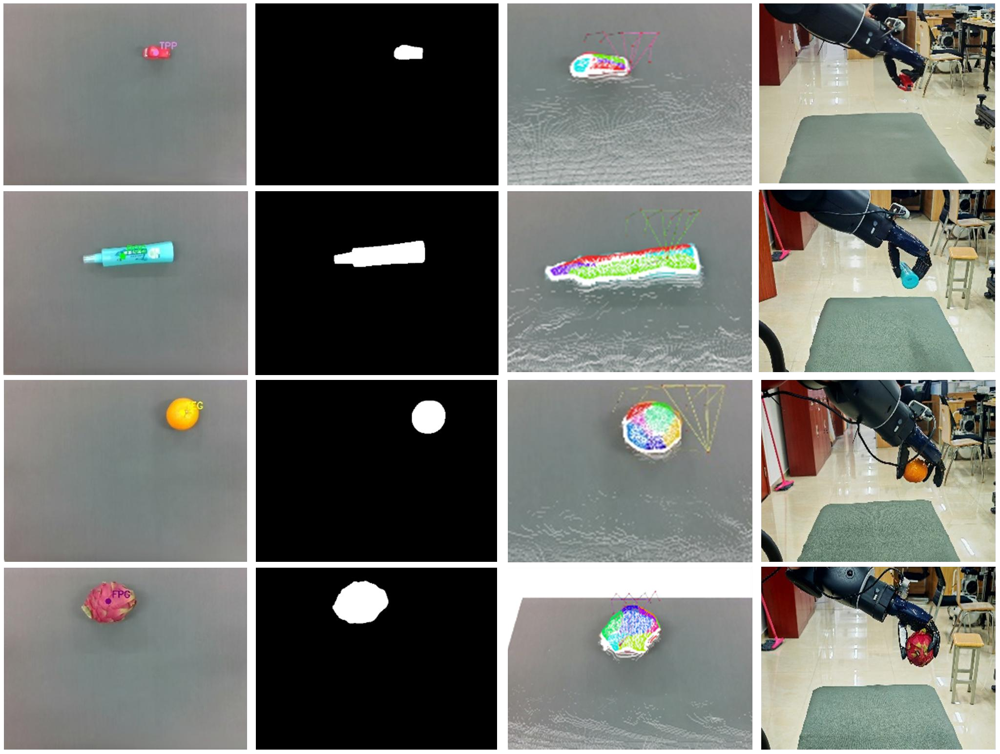

# Baxter-Grasp

## 面向杂乱场景的灵巧手视觉抓取

本项目围绕 Baxter 机器人与 FreeHandy 五指灵巧手，介绍一套融合轻量化多任务抓取检测与先验引导姿态生成的方案。系统从 RGB-D 图像中感知抓取位置、开口宽度与手势类别，再结合目标几何信息生成可执行的抓取姿态，完成从视觉感知到机器人执行的衔接。

对应研究：*Lightweight Multi-Task Grasp Detection and Prior-Guided Pose Generation for Dexterous Hands in Cluttered Scenes*。

## 整体方案

**RGB-D 场景输入 → 抓取检测 → 目标分割与几何建模 → 先验引导姿态生成 → 机器人抓取执行**

- **抓取检测：** 使用轻量化多任务网络 PAG-GraspNet，同时预测抓取质量、抓取宽度与手势类别。通过 S-MCRR 软掩码标签与 ERAM 自适应多任务损失，兼顾抓取区域定位和手势识别。
- **几何建模：** 以预测的抓取中心引导 MobileSAM 分割，提取目标点云；经过点云处理与表面分析，获得适合夹持的对向抓取平面，为姿态生成提供几何约束。
- **姿态生成：** 使用 TGGP 框架，结合手势先验、桌面约束与物体几何进行局部姿态采样；依据夹持方向、接近方向与主轴稳定性筛选候选，再结合逆运动学与关节变化代价确定执行姿态。
- **抓取执行：** 通过手眼标定将抓取姿态转换到机器人坐标系，由 Baxter 与 FreeHandy 配合完成目标抓取，并在多物体场景中逐次移除目标。

方案支持三指对指、五指对指、三指包裹和五指全掌等典型手势，以适应不同形状与尺寸的物体。

## 部分结果展示

### 单物体抓取

下图依次展示网络检测输出、目标分割掩码、生成的抓取姿态与真机抓取过程，体现从视觉预测到执行的完整流程。

### 多物体场景抓取

下图展示杂乱桌面场景中的连续抓取过程：机器人逐次抓取并转移目标，直至清理场景。

*以上图片节选自论文中的真实机器人实验，仅展示定性过程。*

## 实验平台与后续方向

实验平台由 Baxter 双臂协作机器人、FreeHandy 五指灵巧手与 Intel RealSense D435i 深度相机组成，基于 ROS 完成感知、规划与执行。

当前方案对接近夹持极限或表面光滑的物体仍可能出现滑落。后续可结合指尖触觉与力反馈，进一步提升接触过程中的抓取稳定性。
