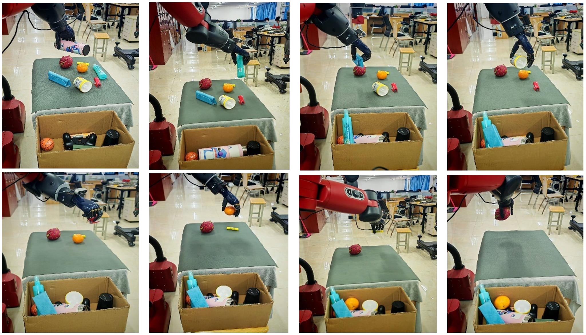

# Baxter+FreeHandy-Grasp

## 多物体场景五指灵巧手视觉抓取

围绕 Baxter 机器人与 FreeHandy 五指灵巧手，介绍一套融合轻量化多任务抓取检测与先验引导姿态生成的方案。系统从 RGB-D 图像中感知抓取位置、开口宽度与手势类别，再结合目标几何信息生成可执行的抓取姿态，完成从视觉感知到机器人执行的衔接。

## 整体方案

**RGB-D 场景输入 → 抓取检测 → 目标分割与几何建模 → 先验引导姿态生成 → 机器人抓取执行**

方案支持三指对指、五指对指、三指包裹和五指全掌等典型手势，以适应不同形状与尺寸的物体。

## 部分结果展示

### 多物体场景抓取

下图展示杂乱桌面场景中的连续抓取过程：机器人逐次抓取并转移目标，直至清理场景。

*以上图片节选自论文中的真实机器人实验，仅展示定性过程。*

## 实验平台与后续方向

实验平台由 Baxter 双臂协作机器人、FreeHandy 五指灵巧手与 Intel RealSense D435i 深度相机组成，基于 ROS 完成感知、规划与执行。

当前方案对接近夹持极限或表面光滑的物体仍可能出现滑落。后续可结合指尖触觉与力反馈，进一步提升接触过程中的抓取稳定性。
